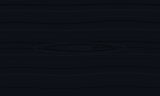

# Revision 2 materials

Opaque matte compartments use three GitHub-dark surface levels. The workspace background uses `--surface-1`, structural panels use `--surface-2`, and raised surfaces and row hover use `--surface-3`. Selected rows, the current navigation item and secondary control hover use `--surface-4` (`selected`). These levels step up from near-black (`#010409`) to `#0A0C10` and `#191C20`, and the 1px `--edge` border (`#7A828E`) carries structure as well. A 1px `--edge` border separates compartments and table rows. Fine rims and shallow field insets keep the tactile treatment. [Reusable CSS tokens](../demo/tokens.css) · [Machine-readable values](tokens.json)

The primary action is a green fill in the default GitHub scheme (`--action`) with a white label (`--action-foreground`). A lighter hover fill and a deeper pressed fill show feedback while keeping the control in place. The fill reaches 3:1 against every surface, so it needs no extra boundary. Secondary controls use `--raised` with a `--border`. Disabled controls use Surface, a muted label and a dashed boundary. Focus and selection use dedicated indicators. Error, warning, success and information keep their own semantic colors and labels.

Body typography starts at 16 CSS pixels under default browser settings and follows user font sizing. Smaller labels and metadata retain their contrast. Grouped controls default to 8px gaps with a 6px minimum. Narrow layouts and coarse pointers use a 44 by 44px minimum for standalone interactive controls and their clickable labels. The reference keeps the 180ms drawer entrance and limits nonessential transitions to 200ms. Reduced-motion and forced-color preferences use the browser's corresponding modes.

## Accent roles

The accent system plays four separate roles. Do not use one value for all of them.

| Role | CSS token | Dark | Light | Application |
| --- | --- | --- | --- | --- |
| Primary action | `--action` · `--action-hover` · `--action-pressed` | `#1A7F37` · `#238636` · `#116329` | `#1A7F37` · `#238636` · `#116329` | The one primary action in a view. Label in `--action-foreground` (`#FFFFFF`). The resting fill sits one step darker than GitHub's button green so the white label meets Tessel's 5:1 target; hover uses GitHub's `#238636` |
| Deep accent | `--accent` | `#15263C` | `#0550AE` | Large tinted regions, such as a selected row band. Always with a marker and a label. Label in `--accent-foreground` measures 14.04:1 (dark) and 6.73:1 (light) |
| Selection | `--selection-indicator` | `#409EFF` | `#0969DA` | Marker beside the selected item and the active-region rule |
| Focus | `--focus` | `#71B7FF` | `#0550AE` | Independent outline with a visible offset |

Use at most one accent element per region. Do not use the brand accent for data series, syntax colors or decoration.

### Other roles

| Role | CSS token | Dark | Light | Application |
| --- | --- | --- | --- | --- |
| Edge | `--edge` | `#7A828E` | `#B8B8BD` | 1px compartment and table borders |
| Control boundary | `--border` | `#7A828E` | `#676772` | Fields and secondary buttons |
| Viewport surround | `--surround` | `#0C0C0C` | `#D6D6D6` | Neutral, chroma-free surround for color-critical viewports. Text and indicators stay legible on it |
| Grid | `--grid` | `#0F1318` | `#F2F2F5` | Grid lines in empty states, canvases and progress segments |
| Error | `--danger` | `#FFA198` | `#9D2B1F` | A labeled error with the affected input and next action |
| Warning | `--warning` | `#F0B72F` | `#735100` | A named warning with the required action |
| Success | `--success` | `#3FB950` | `#236340` | A labeled completion or recovery result |
| Information | `--info` | `#A5D6FF` | `#174E85` | An explanatory label or message |

### Appearance presets

Keep theme and accent color as independent choices. A preset recolors the deep accent, the primary action, the selection marker and the focus outline together, so a Blue or Teal product has no green buttons. GitHub uses the base theme values. Graphite is a neutral preset for color-critical work: its action, selection, focus and accent carry no visible tint. Semantic colors, edges and surfaces do not change.
| Preset | Dark action | Dark selection | Dark focus | Light action | Light selection | Light focus |
| --- | --- | --- | --- | --- | --- | --- |
| GitHub (default) | `#1A7F37` | `#409EFF` | `#71B7FF` | `#1A7F37` | `#0969DA` | `#0550AE` |
| Crimson | `#D02946` | `#DD294B` | `#FF4D73` | `#B40234` | `#9E1534` | `#D61F45` |
| Blue | `#036DCD` | `#5FA8FF` | `#ACD1FF` | `#0059AA` | `#1558A6` | `#327AD1` |
| Teal | `#027B74` | `#37B7AF` | `#8FE4D9` | `#08645E` | `#00665F` | `#13877F` |
| Graphite | `#6D6D74` | `#94949C` | `#DCDCE3` | `#585860` | `#585860` | `#75757D` |

Web consumers set `data-accent` on the document root alongside `data-theme`. The generated CSS resolves Light, Dark and System and uses `Highlight` for both cues in forced colors. Native consumers keep the base dark and light palette API and apply the preset overrides for the effective theme. Store a validated preset ID and fall back to GitHub when it is missing or unknown. Alternate sRGB values are in `color.accentPresets` in the [generated DTCG JSON](../dist/tessel.tokens.json) and as sRGB and OKLCH in the [source tokens](tokens.json).

### State and editing roles

These roles carry the states that need more than `selected`. Columns: Dark, Light, High Contrast.

| Role | CSS token | Dark | Light | High Contrast | Application |
| --- | --- | --- | --- | --- | --- |
| Strong selection | `--selected-strong` | `#40454D` | `#CACAD3` | `#3D444D` | Explorer-style selected row when the list has focus elsewhere, and the active item in a tree |
| Hover | `--hover` | `#20242B` | `#D5D5DD` | `#20242B` | Secondary control and row hover |
| Pressed | `--pressed` | `#2E333B` | `#C9C9D3` | `#2E333B` | Secondary control while pressed |
| Info fill | `--info-fill` | `#0C2D6B` | `#DDF4FF` | `#0C2D6B` | Banner or tag behind `info` text |
| Warning fill | `--warning-fill` | `#3A2A00` | `#FFF8C5` | `#3A2A00` | Banner or tag behind `warning` text |
| Success fill | `--success-fill` | `#0A3318` | `#DAFBE1` | `#0A3318` | Banner or tag behind `success` text |
| Error fill | `--danger-fill` | `#4C1A1A` | `#FFEBE9` | `#4C1A1A` | Banner or tag behind `danger` text |
| Disabled label | `--disabled-foreground` | `#7A828E` | `#7E7E8A` | `#9EA7B3` | Label of a disabled control. At least 3:1 on its fill; WCAG exempts disabled controls |
| Disabled fill | `--disabled-fill` | `#0A0C10` | `#F2F2F5` | `#0A0C10` | Fill of a disabled control, with a dashed `border` |
| Read-only fill | `--read-only-fill` | `#11151B` | `#F4F4F7` | `#11151B` | Fields that show a value but cannot be edited |
| Text selection | `--text-selection` | `#1F4E8F` | `#B6D6FB` | `#1F4E8F` | Selected text. `foreground` stays 4.5:1 on it |
| Find match | `--find-match` | `#5C4A00` | `#FFE97A` | `#5C4A00` | Every match of a find or search |
| Active find match | `--find-match-active` | `#8A5B00` | `#FFD33D` | `#8A5B00` | The current match |

Status fills pair with their text role: `info` on `infoFill`, `warning` on `warningFill`, `success` on `successFill` and `danger` on `dangerFill`, each at least 4.5:1 (tested). A banner still needs an icon and a label.

## High Contrast theme

A fourth theme for low vision, bright rooms and long sessions. It keeps the dark surfaces and raises everything else: text is `#FFFFFF` and `#F0F3F6`, borders are `#F0F3F6`, edges are `#9EA7B3` (at least 5:1), the selection marker is `#79C0FF`, focus is `#FFD33D`, and every text, status, selection and focus color reaches 7:1 on every surface. Set `data-theme="high-contrast"`. Operating-system contrast themes still win: in forced colors every role maps to a system color.

The primary action cannot reach 7:1 for its label and 3:1 for its fill on black at once, so in High Contrast it keeps a deep green fill (`#0A5A23`, label 8.4:1) and gains a 2px `border` outline. The deep accent is `#0A2A5E`. High Contrast has no OKLCH encoding and reuses the dark syntax colors, which measure at least 6.7:1 on every surface.

## Syntax colors

Code and log text has its own set so it never borrows the brand accent or a status color by accident. Roles: `keyword`, `string`, `function`, `constant`, `comment`, `variable`, `tag`, `typeName`. Dark values come from GitHub Dark High Contrast (`#FF9492`, `#ADDCFF`, `#DBB7FF`, `#91CBFF`, `#BDC4CC`, `#FFB757`, `#72F088`, `#F0B72F`). Light values are `#B71C28`, `#0A3069`, `#6639BA`, `#0550AE`, `#57606A`, `#953800`, `#116329`, `#7D4E00`. Each reaches 4.5:1 on all four surfaces of its theme. CSS: `--syntax-keyword` and so on.

## Elevation

Floating layers use a fill, a 1px edge and a shadow. The shadow adds depth but never replaces the edge.

| Level | Fill | Edge | Dark shadow | Light shadow | Use |
| --- | --- | --- | --- | --- | --- |
| Popup (z 100) | `raised` | `edge` | `0 4px 8px #0006` | `0 4px 8px #0000001F` | Menus, dropdowns, context menus |
| Tooltip (z 200) | `selected` | `border` | `0 2px 6px #0006` | `0 2px 6px #0000001F` | Tooltips and hints |
| Dialog (z 300) | `raised` | `border` | `0 8px 24px #000A` | `0 8px 24px #00000033` | Modal dialogs and sheets |

A modal dialog sits on a scrim (`--scrim`: `#000000B3` dark, `#00000066` light). CSS: `--elevation-popup`, `--elevation-tooltip`, `--elevation-dialog`.

## Accent tints

Quiet region fills come from mixing an accent into the background in OKLab at 8%, 16% and 24%: `--selection-indicator-tint-1..3` and `--action-tint-1..3`. A tint is a fill, never a label color. Body text on every tint stays at least 4.5:1 in all three themes (tested). The DTCG export lists the computed hex values.

## Grid signature

The grid is a static, quiet motif that appears in three places:

| Where | Spec |
| --- | --- |
| Empty states and canvases | 24 px square cells, 1px lines in `--grid`. Never behind text-dense content |
| Determinate progress | Ten equal segments with a gap between them. Indeterminate progress uses a moving segment and becomes static under reduced motion |
| Active-region rule | A 2px `--selection-indicator` line under the focused compartment's header. One per window |

`--grid` stays within 1.04–1.3:1 of every surface. Text, selection markers, focus outlines and control boundaries drawn over it keep their normal contrast. Forced colors and reduced-motion modes remove the pattern and keep the status text.

## Dark wood grain

This is an optional texture for exposed dark workspace backgrounds. The default signature is the [grid](#grid-signature). Use a soft, low-contrast wood grain: long, gently wavy horizontal lines of uneven spacing and weight, with a few nested rings for a cathedral figure. Keep the GitHub-dark base, and draw the grain with near-neutral blue-gray values close to the base. The pattern is static and tiles seamlessly.

Use the flat background in Light and forced-color modes, including when System resolves to Light. Check label, boundary, selection, and focus contrast against the brightest grain line. Apply the existing 4.5:1 normal-text and 3:1 required non-text contrast targets.

### Presets

| Preset | Tile geometry | Relief budget | Use |
| --- | --- | --- | --- |
| Wood grain | 160 × 96 CSS px seamless tile, 1 to 1.5 CSS px grain lines | At most 1.15:1 between the brightest and darkest pixels | Exposed dark workspace backgrounds. Repeat at the same size along both axes. |
| Flat | Solid surface | 1:1 within the fill | Light and forced-color modes, dense reading surfaces, fields, and controls. Also offer it as a dark workspace preference. |

The reference swatch uses `#010409` for the base, `#0A0C10` for the lightest grain, `#04070C` for the mid tone and `#000308` for the darkest grain. The tests keep the lightest-to-darkest contrast at or below 1.15:1 and check text, boundary, focus and selection contrast against the lightest grain.

## Measured palette contract

The dark Background, Surface, and Raised OKLCH lightness values are 0.104, 0.154, and 0.225, with low chroma (under 0.02). Their linear-sRGB relative luminance rises by 223% and 213%. The high-contrast dark scheme separates compartments with 1px borders as well as luminance, so the step must be at least 5% and may reach 300%. [CSS Color 4 conversion method](https://www.w3.org/TR/css-color/#color-conversion-code)

| Checked pairing | Dark minimum | Light minimum |
| --- | ---: | ---: |
| Body and muted labels on four surfaces | 8.06:1 | 5.89:1 |
| Semantic labels on four surfaces | 5.59:1 | 5.30:1 |
| Primary label at rest and pressed (hover) | 5.08:1 (4.63:1) | 5.08:1 (4.63:1) |
| Focus outline on four surrounding surfaces | 6.70:1 | 5.62:1 |
| Primary fill against background, surface and raised | 3.37:1 | 4.01:1 |
| Control boundary on surfaces | 3.66:1 | 4.13:1 |
| Edge against background, surface and raised | 4.41:1 | 1.56:1 |
| Selection indicator on four surfaces, including the selected fill | 5.10:1 | 3.84:1 |

Fills that mean different states must also differ from each other. These are fill-to-fill ratios, so they support recognition rather than replace boundaries, markers and labels.

| Distinctness check | Dark | Light | Minimum |
| --- | ---: | ---: | ---: |
| Selected fill against Surface | 1.23:1 | 1.35:1 | 1.10:1 |
| Primary action hover against rest | 1.10:1 | 1.10:1 | 1.05:1 |
| Primary action pressed against rest | 1.46:1 | 1.46:1 | 1.05:1 |
| Grid against surfaces (range) | 1.15–1.17:1 | 1.05–1.13:1 | 1.04–1.30:1 |
| Focus against selection indicator (a focused selected item shows two cues) | 1.80:1 | 1.46:1 | 1.30:1 |

Figures are rounded for display. `node --test demo/tokens.test.mjs` compares unrounded ratios in both encodings, checks CSS and JSON agreement, validates the dark surface steps, and enforces the distinctness minimums. `node tools/build-tokens.mjs --check` confirms that generated outputs match `tokens.json`. [W3C non-text contrast guidance](https://www.w3.org/WAI/WCAG22/Understanding/non-text-contrast)
